# 🌐 Awesome Enterprise Social Network & Intranet

<p align="center">
  
</p>

<p align="center">
  <a href="https://github.com/ishandutta2007/Awesome-Awesome-Awesome"></a>
  <a href="https://discord.gg/jc4xtF58Ve"></a>
  <a href="https://github.com/ishandutta2007/Awesome-Enterprise-Social-Network-Intranet/stargazers"></a>
  <a href="https://github.com/ishandutta2007/Awesome-Enterprise-Social-Network-Intranet/network/members"></a>
  <a href="https://github.com/ishandutta2007/Awesome-Enterprise-Social-Network-Intranet/blob/main/LICENSE"></a>
  <a href="https://github.com/ishandutta2007/Awesome-Enterprise-Social-Network-Intranet/issues"></a>
  <a href="https://github.com/ishandutta2007/Awesome-Enterprise-Social-Network-Intranet/pulls"></a>
  <a href="https://github.com/ishandutta2007"></a>
</p>

---

## 🧭 Curated Directory of Enterprise Social Networks, Intranets & Employee Communication Platforms

> A curated list of **Enterprise Social Network (ESN)** solutions, **modern intranet software**, **digital workplaces**, and **employee communication platforms**. Covering category-leading SaaS platforms with transparent pricing alongside self-hosted, open-source projects for complete data sovereignty.

Whether you are seeking a turnkey cloud-based employee experience (EX) platform with AI copilot summaries or a self-hosted, private open-source social network that complies with strict data residency regulations, this repository indexes the most active, battle-tested solutions.

---

## 📑 Table of Contents
- [📊 Sector Overview & Market Dynaiics](#-sector-overview--market-dynaiics)
- [🏢 SaaS / Hosted Platforms](#-saas--hosted-platforms)
- [💻 Open-Source GitHub Projects](#-open-source-github-projects)
- [📈 Star History](#-star-history)
- [🤝 How to Contribute](#-how-to-contribute)
- [💖 Support](#-support)
- [⚠️ Disclaimer](#️-disclaimer)

---

## 📊 Sector Overview & Market Dynaiics

The global **Enterprise Social Software (ESS)** and **Social Intranet** market is currently estimated at **$25B–$30B** in annual spend and is forecast to expand past **$70B–$100B by the early 2030s** at an estimated CAGR of ~17%–19%.

The market structure is **moderately fragmented**:
- **Platform Giants:** Ecosystem giants (especially Microsoft 365 with Viva Engage, SharePoint, and Teams) provide ubiquitous baseline coverage across large corporate enterprises.
- **Best-of-Breed Innovators:** Rather than becoming a pure "winner-take-all" market, high corporate demand for specialized frontline mobile experiences, AI personalization, non-desk worker engagement, and friction-free culture drives substantial adoption for independent SaaS category leaders (such as Staffbase, LumApps, Simpplr, and Jostle).
- **Data Sovereignty & Self-Hosted Needs:** Strict regulatory requirements (GDPR, HIPAA, and national data sovereignty mandates in Europe and government sectors) sustain healthy demand for self-hosted, open-source intranets like HumHub, eXo Platform, and Discourse.

---

## 🏢 SaaS / Hosted Platforms

| Product 🏷️ | Company Valuation / Revenue 💰 | Description 📝 | Pricing (Starting Tier) 💳 | Free Tier / Trial Limits ⏱️ |
|:---|:---|:---|:---|:---|
| **[Microsoft Viva Engage (Yammer)](https://www.microsoft.com/en-us/microsoft-viva/engage)** | ~$3.8T Market Cap ($280B+ Annual Revenue) | Enterprise social network tightly integrated into Microsoft 365 with communities, storyline feeds, leadership corners, and town hall broadcasting. | **$2.00 /user/month** (standalone Employee Communications and Communities plan) or bundled in M365 suites ($6.00 /user/month for Microsoft 365 Business Basic). | **30-day free trial** for up to 25 users (managed through M365 Admin Center / CSP); no permanent standalone free tier. |
| **[Zoho Connect](https://www.zoho.com/connect/)** | ~$12B–$12.5B Valuation (~$1.5B Annual Revenue) | Unified team social network and collaboration hub with group feeds, knowledge base manuals, internal forums, and custom apps within the Zoho suite. | **Free plan ($0)**; paid tiers start at **$1.00 /user/month** (Enterprise) or flat Starter package at ~$10/month for up to 25 users. | **Free forever plan**: up to 5 users, 3 groups, 3 custom apps, 3 boards, 3 manuals, and 10 integrations. |
| **[Staffbase](https://staffbase.com/)** | $1.1B Valuation (~$190M+ ARR) | Mobile-first employee communications platform with multi-channel intranet, employee news apps, email newsletters, and frontline deskless worker tools. | **$8.00 /user/month** (starting industry estimate for base intranet modules; annual contract with custom enterprise scoping). | **No self-service free trial or permanent free tier**; guided live sandbox evaluation via mobile Demo Hub app and sales-arranged pilot. |
| **[LumApps](https://www.lumapps.com/)** | >$1.0B Valuation (~$150M ARR post-Beekeeper merger) | AI-powered digital workplace and intranet connecting enterprise workforces to critical tools, executive news, personalized content, and communities. | **£32.00 /user/year** (~$3.40 /user/month equivalent via UK G-Cloud base intranet framework; volume tiers require 2+1 year commitment). | **No self-service free trial or free tier**; custom guided Proof of Concept (PoC) and staging environment provided via enterprise sales. |
| **[Simpplr](https://www.simpplr.com/)** | ~$500M+ Implied Valuation (~$50M–$90M ARR) | Modern AI-native employee experience platform delivering personalized intranet content, auto-governance, internal comms, and employee sentiment analytics. | **£4.00 /user/month** (~$5.20 /user/month equivalent via public sector G-Cloud baseline disclosures; custom quote for enterprise). | **14-day trial** available upon request via sales/solutions team; structured pilot programs available for prospective enterprise clients. |
| **[Interact Intranet](https://www.interactsoftware.com/)** | ~$100M–$200M Implied Valuation (~$30M–$45M ARR) | Enterprise-grade intranet software engineered for internal communications, organizational knowledge management, and employee pulse surveys. | **£7.00 /user/month** (~$9.10 /user/month equivalent based on G-Cloud procurement rate card; minimum 12-month contract). | **No standard self-service free trial or free tier**; custom scoped sandbox and guided demonstration arranged via sales team. |
| **[Jostle](https://www.jostle.me/)** | ~$30M–$50M Implied Valuation (~$6M–$10M ARR) | People-centric intranet platform built to boost employee engagement, cultural alignment, peer recognition, and cross-departmental coordination. | **$2.77 /user/month** (Bronze plan, billed annually; per-user pricing scales downward with organizational size). | **30-day free trial** with access to full Platinum enterprise features for up to 15 users; no permanent free tier. |

---

## 💻 Open-Source GitHub Projects

*Sorted in descending order by GitHub stargazer count.*

| Project 🚀 | Star Badge ⭐ | Tech Stack 🛠️ | Description 💡 |
|:---|:---:|:---:|:---|
| **[Discourse](https://github.com/discourse/discourse)** | [](https://github.com/discourse/discourse/stargazers) | Ruby / Ember.js / PostgreSQL | **Customizable, modern community and discussion platform powering 22,000+ organizations.** Features asynchronous topics, real-time chat, AI summaries, multilingual translation, SSO, and rich role permissions for internal knowledge bases and corporate communities. |
| **[HumHub](https://github.com/humhub/humhub)** | [](https://github.com/humhub/humhub/stargazers) | PHP (Yii2) / MariaDB | **The flagship open-source enterprise social network.** Features a flexible AGPLv3 Community Edition with a Facebook-style stream, user spaces, document management, wiki, calendar, and a rich ecosystem of modular add-ons. |
| **[Elgg](https://github.com/Elgg/Elgg)** | [](https://github.com/Elgg/Elgg/stargazers) | PHP / MySQL | **Award-winning open-source social networking engine.** Provides a modular foundation for building customized internal networks, employee hubs, or university intranets with 1,000+ community plugins and fine-grained access control. |
| **[Open Source Social Network (OSSN)](https://github.com/opensource-socialnetwork/opensource-socialnetwork)** | [](https://github.com/opensource-socialnetwork/opensource-socialnetwork/stargazers) | PHP / Ajax / MySQL | **Rapid and lightweight self-hosted social networking software.** Easy to deploy for internal company groups, friend feeds, real-time messaging, employee media sharing, and member collaboration with complete privacy. |
| **[Twake Workplace](https://github.com/linagora/twake-workplace)** | [](https://github.com/linagora/twake-workplace/stargazers) | TypeScript / React / Node.js | **Open-source digital workplace and social collaboration environment.** Provides sovereign hosting with team channels, corporate drive workspaces, enterprise document sharing, audio/video conferencing, and calendar events. |
| **[eXo Platform](https://github.com/exoplatform/platform)** | [](https://github.com/exoplatform/platform/stargazers) | Java / Vue.js / Matrix | **Comprehensive digital workplace and sovereign alternative to proprietary suites.** Offers document repositories, intelligent enterprise search, Matrix-powered real-time chat, social activity streams, and on-premise governance. |
| **[Simoona](https://github.com/VismaLietuva/simoona)** | [](https://github.com/VismaLietuva/simoona/stargazers) | C# / .NET / SQL Server | **Intuitive social intranet engine designed for internal corporate communication.** Built specifically to foster employee recognition, peer acknowledgment, cultural empowerment, and internal company news distribution. |
| **[Uintra](https://github.com/Uintra/Uintra)** | [](https://github.com/Uintra/Uintra/stargazers) | C# / Umbraco CMS (.NET) | **Flexible intranet and social employee platform built on Umbraco CMS.** Enables companies to construct bespoke digital workplaces with bulletin boards, social activity feeds, event calendars, and staff directories. |
| **[Open Intranet](https://github.com/droptica/openintranet)** | [](https://github.com/droptica/openintranet/stargazers) | PHP / Drupal 11 | **Turnkey workplace hub and social intranet distribution built on Drupal.** Includes staff directories, knowledge base books, document management, kudos/social reactions, and AI search capabilities with zero per-user licensing fees. |
| **[Favilla](https://github.com/Myth70/favilla)** | [](https://github.com/Myth70/favilla/stargazers) | PHP 8.2+ / Bootstrap + HTMX | **Lightweight self-hosted workspace and company intranet.** Delivered via one-command Docker setup with OIDC SSO, 20 modular tools, team directories, document sharing, and internal announcements. |

---

## 📈 Star History

[](https://www.star-history.com/#ishandutta2007/Awesome-Enterprise-Social-Network-Intranet&type=date&legend=top-left)

---

## 🤝 How to Contribute

Contributions make the open-source and software ecosystem thrive! To propose a new SaaS platform, update pricing details, or add a self-hosted open-source intranet:

1. 🍴 **Fork the repository** to your personal GitHub account.
2. 🌿 **Create a feature branch**:
   ```bash
   git checkout -b feature/add-new-intranet
   ```
3. ✏️ **Make your changes** in [README.md](file:///C:/Users/ishan/Documents/Projects/Awesome-Enterprise-Social-Network-Intranet/README.md) following the existing tabular schema.
   - For SaaS products: Provide official transparent pricing and specific free trial/plan limits.
   - For open-source tools: Ensure the repo is active and include the social star badge linking to `/stargazers`.
4. 💾 **Commit your changes**:
   ```bash
   git commit -m "Add [Tool Name]: 1-sentence summary"
   ```
5. 🚀 **Push to your branch and open a Pull Request** with a concise description of the addition or update.

---

## 💖 Support

If you found this curated directory helpful for evaluating enterprise social networks or discovering self-hosted intranet alternatives, please consider supporting the project:

- ⭐ **Star this repository** to help others find it on GitHub.
- 🍴 **Fork and share** with colleagues, IT administrators, and internal comms managers.
- ☕ **Buy me a coffee / Sponsor**: If this project saved your team time or research costs, you can sponsor further updates via the [GitHub Sponsors Dashboard](https://github.com/sponsors/ishandutta2007).

Thank you for your encouragement and support! 🙌

---

## ⚠️ Disclaimer

- This list is **community-curated** for educational, architectural, and evaluation purposes; inclusion does not imply official endorsement or commercial sponsorship.
- Enterprise social networks and intranets store sensitive internal employee conversations, organizational data, and directory credentials. Always review security compliances (e.g., SOC 2, ISO 27001, GDPR), data encryption standards, and identity provider (IdP/SSO) integrations prior to production rollout.
- Pricing metrics, trial durations, and open-source licensing terms are subject to change by vendor maintainers; verify details on official vendor websites before purchasing or deploying.

---

<p align="center">
  <b>Built for internal communications leaders, IT administrators, and digital workplace architects worldwide. 🚀</b>
</p>
